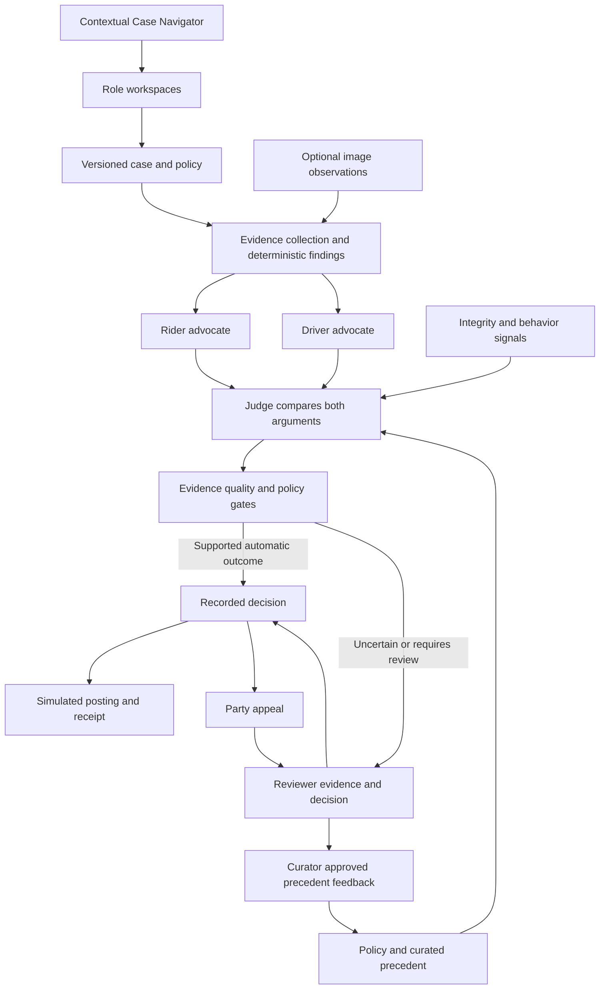

# Rydr — Ride disputes, resolved

**Rydr = Ride + Resolve.** An evidence-backed dispute workflow for riders, drivers and reviewers, built for the Tencent Cloud Singapore hackathon with WorkBuddy and further implementation/verification in Codex.

Rydr turns a disputed ride into an inspectable case: opposing advocates present supported arguments, a judge applies the governing policy, and uncertain or policy-gated cases reach a human reviewer. A decision then leads to an outcome, a simulated financial receipt and a complete appeal loop.

**Judging without credentials:** clone, install, and run `npm run judge:verify`. No ADP account, AppKeys or cloud SecretId/SecretKey are needed for that evaluation. Read [AGENTS.md](AGENTS.md) for coding-agent instructions and [EVALUATION.md](EVALUATION.md) for exact assertions and walkthroughs.

## What judges can verify

| Configuration | Available verification | Boundary |
| --- | --- | --- |
| No secrets, fixture mode | Three-role orchestration, policy arithmetic, evidence citations, human referral, simulated settlement, reviewer/party UX and appeals | Scripted provider output; no live LLM reasoning or pixel understanding |
| Your own published ADP role agents and AppKeys | Live rider advocate, driver advocate and judge, with recorded provider calls and validated outputs | Network access, quota and deployment configuration required; model results may vary |
| Optional Navigator / vision keys and image transport | Contextual guidance and image observations | Independently configured; failure is displayed rather than silently replaced with a fixture |
| Maintainer-hosted deployment or a credentialed rehearsal | Observe the configured live system without obtaining its secrets | A local URL is not accessible to remote judges; no public deployment is promised by this repository |

Fixture runs are permanently labelled **Fixture simulation**. Passing them proves the application contract, not ADP availability or model accuracy. `AGENTS.md` is guidance for an evaluator's coding agent; it is not an API credential and does not turn that agent into Rydr's runtime provider.

## Quickstart — no secrets

Prerequisites: Node.js **22.12 or newer**, npm, and an unused local port. Dependency installation needs internet; the fixture dispute path makes no external AI calls. Some dependencies use native binaries, so an unsupported OS/CPU may require the package's normal native build tools.

```sh
git clone https://github.com/MT7654/rydr.git
cd rydr
npm ci
```

Copy the safe configuration template **only if you do not already have a local configuration**:

```sh
# macOS / Linux
cp .env.example .env
```

```powershell
# Windows PowerShell
Copy-Item .env.example .env
```

Keep these values for the credential-free path:

```dotenv
RYDR_AGENT_MODE=fixture
RYDR_VISION_MODE=fixture
RYDR_MAX_PROVIDER_CALLS_PER_DAY=0
```

The last value blocks paid provider attempts; it is a local guard, not a Tencent billing cap. Empty AppKeys are intentional. Never replace a maintainer's existing `.env` or copy secrets into a bug report.

```sh
npm run judge:verify
npm run dev -- --port 3000
```

Open **http://localhost:3000/** and select **I'm a reviewer → Open Worklist**. Use the same hostname throughout: `localhost` and `127.0.0.1` have separate browser cookies. A fresh session has **18 open cases**, including **DISP-002 v2**.

For a production preview:

```sh
npm run build
npm start -- --port 3000
```

Local production uses `.next-production`; development uses `.next`; Vercel builds use its standard `.next` directory. Run one server per port. Credential-free judging uses local files under ignored `data/runtime/` visitor namespaces. Hosted deployments can use **Neon Postgres and private Neon object storage** for durable shared state and uploaded bytes. Source fixtures remain immutable repository files. See [Neon and Vercel setup](docs/NEON-VERCEL.md). Tests default to isolated local scratch storage.

## Agent/evaluator command

```sh
npm run judge:verify
```

This runs the real orchestrator with an explicitly local fixture provider in fresh test sessions. It checks five cases, both advocate outputs, judge citations, saved snapshots, review tasks and settlement amounts. It writes **`data/judge-evaluation/report.json`**, labelled with `mode: fixture`, `externalPaidCalls: 0`, actual outputs, frozen case/policy inputs and assertions. The command exits nonzero if any assertion fails. It does not require a web server or read the private `.env` to obtain credentials.

| Case | Expected credential-free behavior |
| --- | --- |
| SYN-001 · no-show | Automatic refund of SGD 5.00 |
| SYN-005 · route | Charge upheld; SGD 0.00 refunded |
| DISP-003 · fare/surge | Automatic refund of SGD 4.50 |
| DISP-001 · supplied route | Human review; calculated eligibility SGD 3.44, no automatic award |
| DISP-002 · supplied no-show | Human review; missing accuracy and conflicting policy sources stay unresolved |

These are evaluator assertions, not instructions to force an agent's answer. Supplied expected rulings and synthetic labels are not runtime agent inputs. DISP-002's supplied expected uphold outcome does not override unresolved evidence or the five-minute/eight-minute policy conflict. A human referral is a valid operational result.

## A short browser walkthrough

1. In the reviewer Worklist, open **SYN-001**, then **Run sample assessment**. Watch both advocates and the judge; inspect a full output or source. The recorded refund is distinct from its test-ledger posting.
2. Open **SYN-005** for a second category. Run the sample assessment; the supported detour leads to an upheld charge. **DISP-003** additionally shows the reconciled surge differential.
3. Open **DISP-002**, assess it, and inspect the competing clocks and unknown GPS accuracy. The system creates a human-review task rather than inventing certainty. Request evidence, or record a reasoned reviewer decision after checking the available record.
4. Use **Session controls → Change role**, select rider or driver, and reopen the same case. Respond to a request or appeal a recorded decision with a reason. Switch back to reviewer to accept/reject the appeal; the confirmation displays its actual effect.
5. Use **Start fresh session** to rotate into a new sample namespace. It preserves earlier records and starts all cases open again.

GPS corrections stay claims until source verification. Statement-only acceptance is disabled. Both-party appeals leave the existing decision effective until reviewed. A revised refund posts only the additional amount owed; reducing an already-posted refund requires manual adjustment.

See [EVALUATION.md](EVALUATION.md) for the complete evaluator flow, API-only inspection and optional live checks.

## Architecture and implementation map



| Area | Source |
| --- | --- |
| Next.js App Router / React workspaces | `src/app`, `src/components/workspace` |
| Run state machine and bounded role calls | `src/agents/orchestrator.ts` |
| Evidence catalog, allowlisted retrieval and collection | `src/agents/evidenceService.ts`, `src/agents/collector.ts` |
| Core prompts and output validation | `src/agents/prompts.ts`, `src/agents/validators.ts`, `src/providers/runtimeInput.ts` |
| Policy math, confidence, risk and precedent retrieval | `src/domain` |
| Fixture / ADP SSE adapters | `src/providers/fixture.ts`, `src/providers/adp.ts` |
| Decision completion, human review and test ledger | `src/agents/completion.ts`, `src/app/reviews/actions.ts`, `src/repositories/ledger.ts` |
| Visitor isolation, atomic writes and frozen snapshots | `src/repositories/store.ts`, `src/repositories/snapshots.ts` |
| Independent reimbursement/recovery | `src/repositories/journeys.ts`, `src/components/PaymentPanel.tsx` |
| Contextual guidance and image support | `src/agents/navigator.ts`, `src/providers/vision.ts` |
| Judge-verification harness | `tests/judge-evaluation.test.ts` |

Each live role uses its published ADP AppKey. Local evidence selection saves two selection calls by default. The judge receives both validated advocate cases; deterministic gates can prevent automatic settlement regardless of the model's recommendation. Observable events, source citations, snapshots and call telemetry expose the workflow, without exposing private model chain-of-thought.

## Differentiation and stretch capabilities

- **Prevent before resolving:** pickup clarification and mutual context reduce entrance misunderstandings.
- **Challenge the decisive fact:** source inspection, evidence requests and explicit accuracy corrections create immutable versions instead of rewriting a past assessment.
- **Resolve for both sides:** driver reimbursement is tracked independently from rider recovery; failed recovery does not erase approved driver credit.
- **Policy and precedent:** versioned packs, retrieval and reviewer corrections captured as candidates that require curator approval before reuse.
- **Escalation and routing:** hard policy/evidence gates, confidence, review lanes and aging targets.
- **Collection and integrity:** allowlisted simulated source adapters, live planning/risk tasks where configured, duplication/coordination/history signals. These are review signals, not fraud verdicts.
- **Multimodal evidence:** optional live image observations plus EXIF/C2PA/duplicate checks. Unknown provenance remains unknown; images alone cannot establish causation, capture time or liability.

There is no claim of real platform telemetry integration, calibrated fraud detection, self-training/fine-tuning, certified image authenticity or production SLA enforcement. Generated pickup art is conceptual illustration, never case evidence.

## Optional live Tencent ADP setup

Use your own account and published agents. Core chat calls need AppKeys, not a cloud SecretId/SecretKey. Set private server-side variables in `.env` and restart the server:

```dotenv
RYDR_AGENT_MODE=live
RYDR_AGENT_PROVIDER=adp
RYDR_ADP_ENDPOINT=<HTTP SSE endpoint from your ADP console>
RYDR_ADP_RIDER_APPKEY=<published rider advocate AppKey>
RYDR_ADP_DRIVER_APPKEY=<published driver advocate AppKey>
RYDR_ADP_JUDGE_APPKEY=<published judge AppKey>
RYDR_MAX_PROVIDER_CALLS_PER_DAY=50
```

Use the endpoint documented for your account/edition; the template contains the existing adapter's endpoint example. The core system prompts/contracts are in `src/agents/prompts.ts` and `src/providers/runtimeInput.ts`; publish deployments that obey them. Text output must be valid JSON with valid source/policy IDs. Do not depend on an agent's knowledge base to override the supplied governing policy. Check `/api/health`, then run **Run live assessment** on a fresh case. Inspect the provider-call audit and run export.

Optional keys: `RYDR_ADP_NAVIGATOR_APPKEY` for contextual guidance and `RYDR_ADP_VISION_APPKEY` for an image-capable deployment. Vision also needs `RYDR_VISION_MODE=live`, `RYDR_VISION_PROVIDER=adp`, `RYDR_VISION_VERIFIED=true`, and verified image transport. Automatic transport uses server-only `ADP_SecretId` / `ADP_SecretKey` to obtain temporary upload credentials; a text-agent AppKey alone cannot upload images. See [vision integration](docs/22-live-vision-integration.md) before enabling it. User-upload processing requires separate public-image authorization; do not enable it for private photos without understanding that boundary.

AppKeys, cloud keys, temporary tokens and private session data are **not shipped**. WorkBuddy build credits do not supply the app's runtime credentials. Live failure never silently becomes a fixture run. Current UI verification included a successful live core assessment and a failed Navigator request, which was shown honestly; a configured key does not guarantee provider availability.

## Checks and troubleshooting

```sh
npm run typecheck
npm run lint
npm test
npm run judge:verify
npm run build
```

The Neon integration passed 424 tests with 15 optional external tests skipped; its seven opt-in real-service tests also passed separately. The new evaluator adds five credential-free scenarios; see its generated report for results from your checkout. Historical reports in `docs` are not proof of a new live run.

| Symptom | Action |
| --- | --- |
| Redirect to role picker / API 403 | Select a role. Reviewer actions require reviewer context. |
| Cases seem to lose progress | Use one hostname and the same session; changing roles preserves progress, starting fresh rotates it. |
| Missing ADP credentials / live failure | Use fixture mode for no-secret evaluation, or configure your own deployments. Do not label fixtures live. |
| Native dependency install error | Use supported Node/OS/architecture and the dependency's normal build tools; keep the lockfile. |
| Port 3000 in use | Use another port consistently or stop only the known Rydr process. |
| IDE-injected safe-delete shim blocks build/test cleanup | Run from a standard terminal/environment. Do not remove global protections or recursively delete unrelated paths. |
| Refund pending / failed / manual adjustment | Inspect the recorded decision and test-ledger state separately; use the permitted reviewer recovery action. |

The file backend is designed for a **single local server process**. The Neon backend persists records in Postgres, serializes mutations with database transactions/advisory locks, and stores uploads in a private bucket. Bounded agent execution is attached to the Vercel request lifetime. Public-host verification remains required; this is not an unlimited durable worker queue. The role picker previews permissions and is not verified authentication. All financial actions and platform source adapters are simulations; no funds move and no Ryde notifications are sent.

## Submission and documentation

- [16:9 cover](submission/rydr-cover-1920x1080.png)
- [Architecture image](submission/rydr-architecture-v2.png) / [editable SVG](submission/rydr-architecture-v2.svg)
- [Project description](submission/project-description.md)
- [Agent/evaluator instructions](AGENTS.md) / [evaluation guide](EVALUATION.md)
- [Dataset import and policy conflicts](docs/34-new-supplied-datasets-and-policy.md)
- [Policy grounding](docs/POLICY_GROUNDING.md)
- [UI research component decisions](docs/36-component-research-and-decisions.md)
- [UI implementation and browser verification](docs/37-ui-implementation-status.md)

Older planning documents remain as history and may describe superseded UI. Genuine WorkBuddy/CodeBuddy development-history proof must be submitted separately; this README does not fabricate it. Video materials are not promised as repository files. Source fixtures under `fixtures/` and `reference/` stay immutable, and expected answers are never used as runtime decision oracles.
