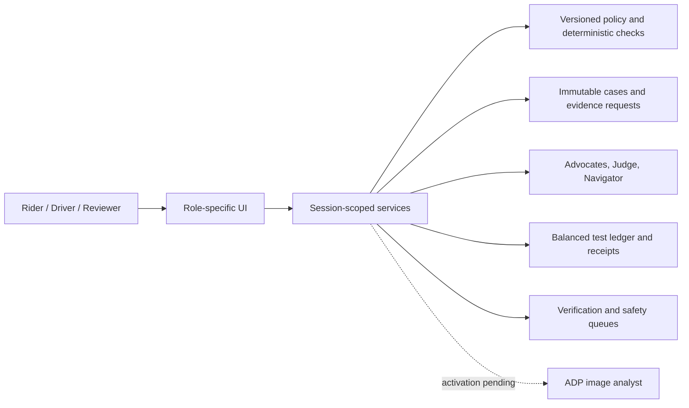

# Rydr walkthrough and submission kit

**Title:** Rydr — Ride disputes, resolved
**Blurb (nine words):** Prevent disputes. Repair evidence. Resolve fairly for both sides.

**Description:** Rydr combines policy-grounded assessment with a complete resolution journey. Separate advocates and a Judge assess cited evidence through live Tencent ADP agents. Case Navigator turns uncertainty into a permitted next action. Pickup clarification helps prevent disputes; evidence repair makes disputed facts actionable; independent reimbursement separates driver relief from rider recovery. Versioned Ryde policies, human verification, private records and balanced test-ledger receipts make each step inspectable. This MVP uses supplied/synthetic cases, role previews and simulated payments.

## Walkthrough

Start a fresh session. DISP-002 should be open. Switch roles within the same session to preserve the journey.

1. **Prevent:** Rider records North entrance, driver South entrance. Driver records contact attempt. Compare 180/181-second waiting checks: unresolved entrance mismatch requires review despite the scripted threshold. Propose one meeting point, both confirm, driver records pickup. No cancellation charge is posted. Safety reporting is a separate reviewer path.
2. **Repair:** Rider opens SYN-006 → Repair evidence. Ask Navigator which record reduces GPS uncertainty. Inspect the finding/source owner, request the source record, obtain a new immutable version and compare changed findings. Explicitly reassess and open outcome. Optionally submit a supporting PDF or proposed correction; show verification is required and another party cannot see the private record.
3. **Resolve both sides:** Driver submits SYN-015 cleaning claim with synthetic photo/professional receipt. Reviewer checks timing, linkage, tier and responsibility, approves S$25 and records reimbursement. Driver receipt shows credit while rider recovery remains pending. Ask Navigator whether reimbursement must wait. Show the separate tracks, rider challenge/reviewer actions and downloadable own-account receipts/journey records.
4. **Inspect:** Reviewer opens Operations and Policies; show exposure, queues and official/proposed policy distinctions. Open live core assessment provenance/citations. Keep raw transcripts collapsed.

Show concrete changes: clarified pickup, repaired finding and reassessment, driver reimbursement before collection. No independent user study has measured percentage savings or real-world accuracy.

## Architecture

## Vision activation last

Publish ADP Image Evidence Analyst with Kimi 2.5 image understanding, using 05-image-evidence-analyst.txt. Store RYDR_ADP_VISION_APPKEY server-side; do not send it in chat. Set RYDR_VISION_PROVIDER=adp, retaining inactive/fixture mode until ready.

Upload an authorized nonsensitive image via ADP/COS. Link its cloud URL in reviewer image evidence; Rydr verifies downloaded bytes match the case image hash before calling ADP. Localhost is unsuitable. Rydr does not publish or upload an image automatically.

For a controlled live test set RYDR_VISION_MODE=live and RYDR_VISION_VERIFIED=true, restart and analyze one image. Inspect actual returned provenance/receipt. Disable live mode if the deployment fails. No scripted answer is substituted. Visible observations do not establish authenticity, capture time, trip linkage or responsibility.

Reference: https://adp.tencent.com/zh/document/218682747739893760 (native image input).

## Submission checklist

Prepared: title, blurb, description, architecture, walkthrough and submission/rydr-cover.svg (export to required format). Source contains functional and live verification reports.

User/account actions: verify public repository URL; record walkthrough; provide at least three genuine WorkBuddy/CodeBuddy chat captures; upload materials and confirm submission. Check general and challenge-specific handbook deliverables. Nothing has been submitted automatically.
