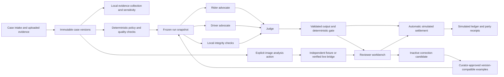

# Rydr completion — 2 October 2026

Rydr = Ride + Resolve. Rydr — Ride disputes, resolved.

WorkBuddy's BUILD_STATE stopped after stretch tasks 0–1, but its source already contained tasks 2–5: routing and service targets, precedents with curator activation, integrity assessments, targeted factual challenges and operations insight. Those features were preserved. The unfinished damage code caused seven TypeScript errors and fabricated fixture observations from hash suffixes.

## Completed here

- Current-next-step navigation links cases directly to the reviewer workbench and party decisions/receipts. Disabled approval placeholders are replaced by working receipt links.
- Damage intake, immutable image evidence versions, safe decoded JPEG/PNG/WebP uploads, original-byte SHA-256, preserved originals and metadata-stripped previews. Four images maximum, 5 MB each, 20 million input pixels; no SVG uploads or animated image packets.
- Actual damage labels and a damage-specific checklist. Synthetic fixtures SYN-009 (three drawn views) and SYN-010 (reuse, time conflict, ordinary-wear annotation and inadequate views). These are illustrations, not photographs or live vision results.
- Exact duplicates and coarse near-duplicate suggestions. Similarity can produce false positives; it does not establish manipulation. Editable timestamps and submitted trip linkage do not establish capture truth. Content credentials are explicitly not checked.
- Independent fixture/live/blocked vision modes. Fixture mode uses scripted annotations and leaves unknown facts unknown. Live vision uses a configurable HTTPS bridge with a validated response contract, actual image bytes, bounded timeout, explicit action and no automatic retries or fixture fallback. The bridge is not an ADP API implementation.
- Recorded image-analysis attempts and case-version caching. Up to four calls per explicit action, one per image. Failed or interrupted attempts remain recorded; refreshing cannot automatically spend again. Before configuring a different model, start a new evidence version rather than expecting a cached receipt to represent the new model.
- Immutable exports include the actual evidence, precedent manifest, integrity assessment and vision receipts captured when the run began. Later analysis does not change a historical export.
- Integrity results reach the Judge as inspection signals, never proof of fraud. Damage always requires reviewer approval before simulated settlement.
- Precedents require both the governing pack ID and version. A reviewer changing a partial-refund amount creates an inactive candidate even when the disposition is unchanged.
- Operations data is read at request time. Default app runs now use local evidence selection and three role invocations; `RYDR_EVIDENCE_SELECTION=model` restores the optional five-call selection pipeline. Repairs still use existing caps. History is excluded from locally selected liability evidence.
- Synthetic evaluation and credit-safe tests. Live ADP tests require both credentials and `RYDR_RUN_LIVE_TESTS=true`; simply running tests cannot accidentally consume credits.

## Run and demonstrate

From `D:\WorkBuddy\Rydr`, run `npm run dev`, or `npm run build` followed by `npm start`. Existing `.env` and runtime records are preserved. Restart an already-running server after applying these changes. Production build/start scripts use .next-production so WorkBuddy development servers cannot overwrite production artifacts.

1. Open SYN-001 in fixture mode, start review and inspect the simulated refund, receipts and evidence citations.
2. Open SYN-006, collect available source evidence, inspect the new case version and sensitivity panel, then explicitly review it.
3. Open SYN-007: evidence retrieval cannot resolve an undefined policy clock. Inspect the policy-owner escalation.
4. Inspect Review queue routing, deadlines and integrity signals. Record a supported reviewer decision and follow through to the settlement/receipt page; human review is an operational handoff, not the end of the flow.
5. In Precedents, inspect an inactive correction candidate, run the curator's gate, approve it and review a different comparable case. Historical reports keep their original retrieval manifest.
6. Open SYN-009 and SYN-010. Inspect the clearly synthetic images, run fixture image analysis and start the text review. Damage goes to human review with no automatic monetary amount. For a new damage case, file it through intake, then upload demonstration images on its case page.
7. Inspect Operations and export a run's JSON report.

## Vision configuration

Default: `RYDR_VISION_MODE=fixture`. For a verified service, set `RYDR_VISION_MODE=live`, `RYDR_VISION_VERIFIED=true`, `RYDR_VISION_ENDPOINT` (HTTPS), `RYDR_VISION_API_KEY` and `RYDR_VISION_MODEL`. Otherwise live mode is blocked. Existing text ADP configuration remains independent; no additional ADP agents are required for local routing, retrieval, collection, integrity checks or operations summaries.

The bridge accepts POST JSON `{ model, instruction, image: { mimeType, base64 } }` and returns `{ description, sufficiency, wearAndTear, linkedToTrip, metadataPresent, metadataConsistent }`. `sufficiency` is `adequate`, `inadequate_angles` or `missing_context`; the nullable facts must be `null` when unknown. The app forces trip linkage and metadata consistency back to unknown because pixels alone cannot establish them. Provider tokens and price are unavailable through this contract; no cost estimate is fabricated. Actual live capability testing remains pending credentials and a separately authorized test.

Image analysis assists reviewer inspection; it cannot override deterministic liability or create a charge. Uploaded images are labelled as unverified demo submissions. Original bytes may contain private details and metadata; previews strip metadata but do not automatically redact visible people or documents. Use synthetic/non-sensitive demo images. Local runtime retention follows the existing demo directory; this prototype has no production account isolation, payment integration or automatic retention service.

## Architecture and trust boundaries

Evidence and statements are untrusted data, not instructions. Policy is authoritative; precedent is context. Expected evaluation labels stay outside runtime agents and providers. Routing and history do not decide liability. No real payment or external message is sent by the prototype.

## Validation

See `synthetic-evaluation-report.json` for measured results, sample size and limitations. The report covers eight hand-authored synthetic cases using the local scripted fixture provider: 50% automatic-resolution coverage, 100% agreement with the synthetic labels, zero wrongful automatic outcomes and zero unnecessary escalations against those labels. Ordinary app runs take three role invocations. These results do not establish production LLM accuracy or fairness. Latencies reflect local file writes and test-runner load.

TypeScript, ESLint, the non-live suite and a production build were checked. UI smoke checks cover the case, investigation and resolution handoff. No live ADP or paid vision calls were made during completion. Near-duplicate detection, AI-generated-image detection, visual redaction and causal attribution are not validated production capabilities; near duplicates are inspection suggestions only, and the other capabilities are not claimed.

## Current status — 14 October 2026

The bridge/pending-vision configuration above is historical. Native live ADP image transport is configured and verified; see docs/22-live-vision-integration.md. The completed assurance paths, 390 passing tests and recorded 7:50 demo are documented in docs/33-stretch-completion-and-recorded-demo.md. Submission assets are in submission/.
